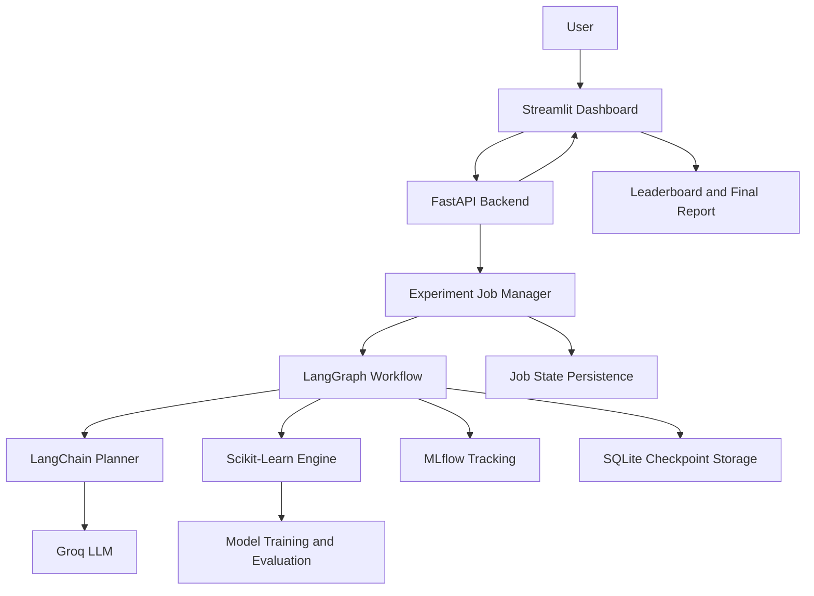
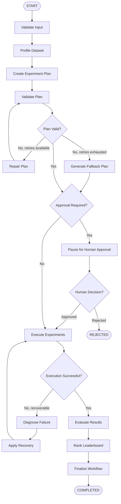

# AutoML Experiment Orchestrator


**An intelligent, agentic AutoML platform that automates machine learning experimentation through stateful AI orchestration, adaptive failure recovery, leakage-free model evaluation, and experiment tracking.**

AutoML Experiment Orchestrator is designed to simplify the end-to-end machine learning lifecycle. Users can upload structured datasets, analyze data quality, configure experiments, generate model proposals, execute multiple ML candidates, compare performance, and identify the best-performing model through an interactive dashboard.

Unlike conventional AutoML implementations, this platform combines LLM-assisted experiment planning with deterministic validation, controlled execution, and transparent evaluation.

### Key Technologies

- **LangGraph:** Stateful workflow orchestration, conditional routing, retry mechanisms, and Human-in-the-Loop approval.
- **LangChain:** Structured LLM-powered experiment planning, plan validation feedback, and model explanations.
- **Groq:** LLM inference provider with deterministic fallback when unavailable.
- **Scikit-Learn:** Model training, preprocessing pipelines, cross-validation, and evaluation.
- **MLflow:** Experiment tracking, parameter logging, metric tracking, and model artifacts.
- **FastAPI:** REST API and background experiment management.
- **Streamlit:** Interactive analytical dashboard and workflow monitoring.

---

## Table of Contents

1. [Project Overview](#1-project-overview)
2. [System Architecture](#2-system-architecture)
3. [Technology Stack](#3-technology-stack)
4. [LangGraph Workflow Lifecycle](#4-langgraph-workflow-lifecycle)
5. [Core Features](#5-core-features)
6. [Machine Learning Pipeline](#6-machine-learning-pipeline)
7. [Benchmark Results](#7-benchmark-results)
8. [Project Structure](#8-project-structure)
9. [Installation and Setup](#9-installation-and-setup)
10. [Running the Application](#10-running-the-application)
11. [REST API Documentation](#11-rest-api-documentation)
12. [Dashboard Workflow](#12-dashboard-workflow)
13. [Testing and Verification](#13-testing-and-verification)
14. [Security and Resource Management](#14-security-and-resource-management)
15. [Current Limitations and Future Improvements](#15-current-limitations-and-future-improvements)
16. [License](#16-license)

---

## 1. Project Overview

Traditional machine learning experimentation involves several repetitive activities:

- Understanding and profiling datasets.
- Selecting appropriate machine learning algorithms.
- Configuring hyperparameters.
- Training and evaluating multiple models.
- Handling training failures.
- Comparing model performance.
- Tracking experiments and saving trained models.

This platform automates these activities through an orchestrated workflow.

### Problems Addressed

| Problem | Platform Solution |
|---|---|
| Manual model selection | LLM-assisted model planning |
| Invalid model configurations | Schema validation and model catalogue |
| Data leakage | Fold-isolated preprocessing |
| Failed experiments | Diagnostic failure recovery |
| Uncontrolled execution | Bounded retries and resource limits |
| Lack of transparency | Real-time workflow monitoring |
| Unverified model performance | Separate validation and test evaluation |
| LLM service unavailability | Deterministic fallback mechanism |

### Main Objectives

1. Automate machine learning experimentation.
2. Introduce agentic workflow orchestration using LangGraph.
3. Generate structured experiment plans using LangChain and Groq.
4. Ensure reliable and leakage-free model evaluation.
5. Provide adaptive recovery when experiments fail.
6. Track experiments using MLflow.
7. Provide an interactive dashboard for monitoring and analysis.

---

## 2. System Architecture

The platform follows a modular architecture with separate responsibilities for the frontend, API, orchestration engine, machine learning execution, and experiment tracking.

### High-Level Architecture



### Architecture Components

| Component | Responsibility |
|---|---|
| Streamlit | User interface and experiment dashboard |
| FastAPI | REST API and request handling |
| JobManager | Background job execution and lifecycle management |
| LangGraph | Workflow orchestration and state management |
| LangChain | LLM integration and structured planning |
| Groq | LLM inference |
| Scikit-Learn | Model training and evaluation |
| MLflow | Experiment tracking and model artifacts |
| SQLite | Workflow checkpoint persistence |
| File Storage | Dataset and job-related persistence |

### Architecture Principles

**Separation of Concerns**

Each component has a clearly defined responsibility.

**Controlled AI Execution**

The LLM proposes experiment configurations but does not generate or execute arbitrary Python code.

**Deterministic Validation**

Model families, hyperparameters, and experiment constraints are validated before execution.

**Reliable Fallback**

The system can continue operating without an available LLM service through deterministic planning.

---

## 3. Technology Stack

| Category | Technology |
|---|---|
| Programming Language | Python |
| Frontend | Streamlit |
| Backend | FastAPI |
| API Server | Uvicorn |
| AI Orchestration | LangGraph |
| LLM Framework | LangChain |
| LLM Provider | Groq |
| Machine Learning | Scikit-Learn |
| Data Processing | Pandas, NumPy |
| Experiment Tracking | MLflow |
| Checkpoint Storage | SQLite |
| Validation | Pydantic |
| Testing | Pytest |
| Version Control | Git and GitHub |

---

## 4. LangGraph Workflow Lifecycle

LangGraph is the central orchestration engine of the platform.

It manages the complete experiment lifecycle through a collection of specialized nodes connected using conditional transitions.

Instead of executing every operation through a fixed sequence, the workflow can make decisions based on validation results, execution errors, retry limits, and human approval.

### 4.1 Workflow Architecture

The following diagram represents the workflow lifecycle.



### 4.2 Workflow Nodes

| Node | Responsibility |
|---|---|
| `validate_input` | Validates dataset, target column, constraints, and resource limits. |
| `profile_data` | Analyzes dataset statistics, datatypes, missing values, and task type. |
| `create_plan` | Generates model candidates using LangChain and Groq or deterministic fallback. |
| `validate_plan` | Validates model families and hyperparameters against the supported catalogue. |
| `repair_plan` | Attempts to correct invalid experiment configurations. |
| `approval_gate` | Determines whether human approval is required before training. |
| `execute_experiments` | Executes baseline and candidate model training. |
| `diagnose_failure` | Identifies the reason behind a failed experiment. |
| `apply_recovery` | Applies appropriate corrections before retrying execution. |
| `evaluate_results` | Evaluates the selected champion on the held-out test dataset. |
| `rank_leaderboard` | Ranks candidates using validation metrics. |
| `finalize_workflow` | Generates the final experiment report and champion insights. |

### 4.3 Conditional Routing

The workflow supports multiple execution paths.

**Plan Validation**

- Valid plan: Continue to the approval gate.
- Invalid plan: Attempt plan repair.
- Retry limit reached: Use deterministic fallback planning.

**Human Approval**

- Approval disabled: Start model execution.
- Approval enabled: Pause and save workflow state.
- Approved: Resume experiment execution.
- Rejected: Terminate the experiment gracefully.

**Failure Recovery**

- Successful execution: Continue to evaluation.
- Recoverable failure: Diagnose and apply corrections.
- Unrecoverable failure: Terminate the workflow with an appropriate status.

### 4.4 Human-in-the-Loop Approval

The platform supports checkpoint-backed approval before model training.

When approval is enabled:

1. The workflow generates an experiment plan.
2. The proposed candidates are validated.
3. The workflow pauses at the approval checkpoint.
4. The user reviews the proposed configurations.
5. The user approves or rejects the experiment.
6. Approved experiments resume from their saved state.

SQLite-based checkpoint persistence allows the workflow to retain its execution state while waiting for a decision.

### 4.5 Adaptive Failure Recovery

The system identifies different types of execution failures.

| Error Category | Possible Recovery |
|---|---|
| `CONVERGENCE_ERROR` | Increase iteration limits or adjust solver settings. |
| `TIMEOUT_ERROR` | Apply execution limits or reduce workload. |
| `RESOURCE_ERROR` | Reduce resource-intensive configurations. |
| `INVALID_HYPERPARAMETERS` | Correct invalid parameter values. |
| `PREPROCESSING_ERROR` | Diagnose incompatible data transformations. |
| `UNSUPPORTED_MODEL` | Remove unsupported candidates. |
| `UNKNOWN_ERROR` | Record and handle the failure safely. |

Recovery attempts are bounded to prevent uncontrolled execution loops.

---

## 5. Core Features

### 5.1 Automated Dataset Profiling

The platform analyzes uploaded CSV datasets and provides:

- Dataset dimensions.
- Column names and data types.
- Missing value analysis.
- Numerical statistical summaries.
- Categorical feature information.
- Target column selection.
- Supervised learning task detection.
- Classification class balance analysis.

### 5.2 Intelligent Experiment Planning

The experiment planner uses LangChain and Groq to generate structured model proposals.

The proposed configurations are validated using Pydantic schemas and a predefined model catalogue.

Supported model families include:

**Classification**

- Logistic Regression
- Ridge Classifier
- Random Forest Classifier
- Gradient Boosting Classifier
- Extra Trees Classifier
- Hist Gradient Boosting Classifier

**Regression**

- Linear Regression
- Ridge Regression
- Lasso Regression
- Random Forest Regressor
- Gradient Boosting Regressor
- Extra Trees Regressor

### 5.3 Deterministic Fallback

The platform does not depend entirely on external LLM availability.

If the Groq API key is missing or the LLM service fails, the system can generate deterministic model proposals and template-based explanations.

### 5.4 Automated Model Benchmarking

The system compares multiple candidates against a baseline model.

Supported evaluation metrics include:

**Classification**
- Accuracy
- Precision
- Recall
- F1-score
- ROC-AUC

**Regression**
- R²
- RMSE
- MAE

### 5.5 Experiment Tracking

MLflow records:

- Experiment parameters.
- Candidate model configurations.
- Validation metrics.
- Training durations.
- Dataset SHA-256 fingerprints.
- Champion model artifacts.

### 5.6 Workflow Observability

The Agent Workflow Inspector provides visibility into:

- Executed workflow nodes.
- Node execution durations.
- State transitions.
- Conditional routing decisions.
- Plan repair attempts.
- Failure diagnosis information.
- Execution traces.

---

## 6. Machine Learning Pipeline

The platform follows a structured machine learning evaluation process.

### 6.1 Data Preparation

The dataset is divided into training and testing partitions before model preprocessing.

Default configuration:

- Training data: 80%
- Testing data: 20%
- Cross-validation: 3 folds

These values can be adjusted through experiment constraints.

### 6.2 Leakage-Free Preprocessing

The platform uses Scikit-Learn pipelines and ColumnTransformer.

Numerical preprocessing:

- SimpleImputer using median strategy.
- StandardScaler.

Categorical preprocessing:

- SimpleImputer using most frequent strategy.
- OneHotEncoder with unknown category handling.

Preprocessing transformations are fitted independently inside each cross-validation training fold.

### 6.3 Cross-Validation

Classification tasks use stratified cross-validation.

Regression tasks use standard KFold cross-validation.

The model candidates are compared using validation scores.

### 6.4 Baseline Comparison

The system includes simple baseline models:

- DummyClassifier for classification.
- DummyRegressor for regression.

These baselines help determine whether trained models provide meaningful improvements.

### 6.5 Champion Selection

The best-performing candidate is selected using the configured primary validation metric.

The held-out test dataset is not used for model selection.

After the champion is selected, the test dataset is evaluated separately to measure generalization performance.

---

## 7. Benchmark Results

The following benchmark represents an execution on the Wisconsin Breast Cancer Diagnostic Dataset.

### Dataset Information

| Property | Value |
|---|---|
| Dataset | Wisconsin Breast Cancer |
| Total Samples | 569 |
| Features | 30 |
| Total Columns | 31 |
| Task | Binary Classification |
| Training Samples | 455 |
| Test Samples | 114 |
| Cross-Validation | 3-Fold Stratified |
| Primary Metric | F1-Macro |

### Model Leaderboard

| Rank | Model | Mean CV F1-Macro | CV Standard Deviation | Training Time |
|---|---|---:|---:|---:|
| 1 | Logistic Regression | **0.9764** | ±0.0106 | 0.33s |
| 2 | Random Forest Classifier | 0.9532 | ±0.0195 | 2.03s |
| 3 | Gradient Boosting Classifier | 0.9484 | ±0.0204 | 1.59s |
| 4 | Dummy Majority Baseline | 0.3851 | ±0.0000 | 0.28s |

### Champion Model

**Selected Model:** Logistic Regression

| Metric | Result |
|---|---:|
| Validation CV F1-Macro | 0.9764 |
| Test F1-Macro | 0.9825 |
| Test Accuracy | 0.9825 |
| Test ROC-AUC | 0.9954 |
| Generalization Gap | +0.0061 |

Champion configuration:

- Model: Logistic Regression
- C: 1.0
- Max Iterations: 1000
- Scaling: StandardScaler
- Imputation: Median

The benchmark demonstrates the platform's ability to compare candidate models, select a champion using validation metrics, and evaluate its performance on a separate held-out test dataset.

*These results represent the documented benchmark execution and are not guaranteed for other datasets or configurations.*

---

## 8. Project Structure

The following is the logical organization of the application. Refer to the repository for the exact current directory and file names.

```text
automl-experiment-orchestrator/
│
├── src/
│   └── automl/
│       ├── api/
│       │   └── app.py
│       │
│       ├── ui/
│       │   └── app.py
│       │
│       ├── planner/
│       │   └── catalogue.py
│       │
│       ├── graph/
│       │
│       ├── trainer/
│       │
│       ├── profiler/
│       │
│       ├── tracking/
│       │
│       └── core/
│
├── tests/
│   ├── unit/
│   └── integration/
│
├── examples/
│   └── run_ui_journey_demo.py
│
├── artifacts/
│
├── requirements.txt
├── .env.example
├── .gitignore
└── README.md
```

---

## 9. Installation and Setup

### Prerequisites

- Python 3.10 or later.
- Git.
- pip.
- Groq API key (optional).

### Step 1: Clone the Repository

```bash
git clone https://github.com/HimanshuMali701/automl-experiment-orchestrator.git

cd automl-experiment-orchestrator
```

### Step 2: Create a Virtual Environment

Windows:

```bash
python -m venv venv
```

Activate the environment:

```bash
.\venv\Scripts\activate
```

Linux/macOS:

```bash
python -m venv venv

source venv/bin/activate
```

### Step 3: Install Dependencies

```bash
python -m pip install --upgrade pip

pip install -r requirements.txt
```

### Step 4: Configure Environment Variables

Create a `.env` file in the project root.

```ini
# API Configuration
API_HOST=127.0.0.1
API_PORT=8000

# Backend URL
AUTOML_API_BASE_URL=http://127.0.0.1:8000

# Resource Management
MAX_CONCURRENT_JOBS=2
MAX_UPLOAD_SIZE_MB=50
MAX_DATASET_ROWS=100000
MAX_DATASET_COLS=200
MAX_TRAINING_TIME_SECONDS=600

# Checkpoint Storage
CHECKPOINT_DB_PATH=./artifacts/checkpoints.db

# MLflow Configuration
MLFLOW_TRACKING_URI=file:./mlruns
MLFLOW_DEFAULT_EXPERIMENT_NAME=automl-experiments

# Groq Configuration
GROQ_API_KEY=your_groq_api_key
GROQ_MODEL=openai/gpt-oss-20b
```

**Note:** Groq integration is optional if deterministic fallback is enabled. Use the model identifier supported by your Groq account and the application's provider configuration.

Never commit your actual `.env` file or API credentials to GitHub.

---

## 10. Running the Application

The application consists of two independently running services.

Open two separate terminals from the project root.

### Terminal 1: Start FastAPI Backend

Activate the virtual environment:

```bash
.\venv\Scripts\activate
```

Run the backend:

```bash
uvicorn automl.api.app:app --host 127.0.0.1 --port 8000 --reload
```

Backend URL:

```text
http://127.0.0.1:8000
```

Interactive API documentation:

```text
http://127.0.0.1:8000/docs
```

### Terminal 2: Start Streamlit Frontend

Activate the virtual environment:

```bash
.\venv\Scripts\activate
```

Start Streamlit:

```bash
streamlit run src/automl/ui/app.py --server.port 8501
```

Dashboard URL:

```text
http://localhost:8501
```

### Running the Complete Demo

To execute the programmatic end-to-end demonstration:

```bash
python examples/run_ui_journey_demo.py
```

---

## 11. REST API Documentation

The FastAPI backend exposes REST endpoints for dataset validation, experiment management, approval, and result retrieval.

| Method | Endpoint | Description |
|---|---|---|
| GET | `/health` | Backend health and job information |
| POST | `/datasets/validate` | Upload and validate a CSV dataset |
| POST | `/experiments` | Create a new experiment |
| GET | `/experiments/{id}` | Retrieve experiment status |
| GET | `/experiments/{id}/results` | Retrieve leaderboard and results |
| GET | `/experiments/{id}/approval` | Retrieve pending approval details |
| POST | `/experiments/{id}/approval` | Approve or reject an experiment |
| GET | `/experiments/{id}/trace` | Retrieve workflow execution trace |

### API Documentation

Once the backend is running, access:

- Swagger UI: `http://127.0.0.1:8000/docs`
- ReDoc: `http://127.0.0.1:8000/redoc`

---

## 12. Dashboard Workflow

The Streamlit dashboard provides an interactive interface for the complete experimentation process.

### Stage 1: Dataset Ingestion and Validation

- Upload CSV datasets.
- Validate dataset structure.
- Inspect row and column counts.
- Check dataset health.

### Stage 2: Dataset Profile and Diagnostics

- Review dataset statistics.
- Inspect missing values.
- Analyze feature types.
- Identify classification or regression tasks.

### Stage 3: Configure and Launch Experiment

- Select target column.
- Configure experiment constraints.
- Select evaluation metric.
- Configure cross-validation folds.
- Set test split ratio.
- Enable or disable human approval.

### Stage 4: Execution Progress and Human Approval

- Monitor workflow execution.
- Track current processing stage.
- Review proposed model configurations.
- Approve or reject experiment plans.
- Observe execution progress.

### Stage 5: Model Benchmark Leaderboard

- Compare candidate models.
- Review validation metrics.
- Compare candidates against baselines.
- Identify the champion model.

### Stage 6: Candidate Details and Hyperparameters

- Inspect individual model configurations.
- Review hyperparameters.
- Examine fold-level scores.
- Compare training durations.

### Stage 7: Final Report and Champion Insights

- Review final test metrics.
- Examine generalization performance.
- View champion explanations.
- Inspect MLflow experiment tracking information.

### Agent Workflow Inspector

The observability interface provides:

- Workflow node execution history.
- Execution duration.
- State transitions.
- Conditional routing information.
- Plan repair logs.
- Failure diagnosis traces.
- Raw execution details.

---

## 13. Testing and Verification

The project includes unit tests and integration tests covering core application functionality.

### Run All Tests

```bash
pytest -v
```

### Run Unit Tests

```bash
pytest tests/unit -v
```

### Run Integration Tests

```bash
pytest tests/integration -v
```

### Test Coverage

| Test Module | Testing Scope |
|---|---|
| `test_env_sanity.py` | Environment and dependency validation |
| `test_profiler.py` | Dataset profiling |
| `test_trainer.py` | Model training and preprocessing |
| `test_planner.py` | Experiment planning |
| `test_tracking.py` | MLflow tracking |
| `test_workflow.py` | LangGraph workflow execution |
| `test_user_constraints.py` | User constraint propagation |
| `test_planner_reflection.py` | Plan repair and validation |
| `test_adaptive_recovery.py` | Failure diagnosis and recovery |
| `test_approval.py` | Human approval and checkpointing |
| `test_observability.py` | Workflow tracing |
| `test_qa_portfolio_readiness.py` | End-to-end quality checks |
| `test_ui.py` | Streamlit UI testing |
| `test_api.py` | API integration |
| `test_scenarios_e2e.py` | End-to-end workflow scenarios |

### Verified End-to-End Scenarios

The documented integration suite covers the following scenarios:

| Scenario | Description |
|---|---|
| A | Normal classification workflow |
| B | Normal regression workflow |
| C | LLM unavailable and deterministic fallback |
| D | Invalid LLM plan and successful repair |
| E | Invalid plan and retry exhaustion |
| F | Candidate failure and adaptive recovery |
| G | Unrecoverable candidate failure |
| H | Human approval and successful resume |
| I | Human rejection |
| J | Custom experiment constraints |
| K | MLflow tracking and artifact persistence |
| L | Real-time workflow observability |

---

## 14. Security and Resource Management

### Security Guardrails

The platform incorporates several safety mechanisms:

- No arbitrary Python or shell command execution from LLM responses.
- Strict model catalogue and hyperparameter validation.
- Structured output validation using Pydantic.
- Sanitized exception handling.
- Dataset privacy considerations.
- API credentials managed through environment variables.

### Resource Limits

| Configuration | Default |
|---|---:|
| Maximum Upload Size | 50 MB |
| Maximum Dataset Rows | 100,000 |
| Maximum Dataset Columns | 200 |
| Maximum Concurrent Jobs | 2 |
| Maximum Training Time | 600 seconds |

These limits help prevent excessive resource consumption during experimentation.

---

## 15. Current Limitations and Future Improvements

### Current Limitations

**1. Structured Tabular Data**

The platform currently focuses on structured tabular datasets. Computer vision, raw text classification, and time-series experimentation are outside the current scope.

**2. Local Background Job Management**

The current implementation uses a local background execution mechanism. Distributed production deployments would require a dedicated task queue and shared state infrastructure.

**3. Traditional Machine Learning Models**

The current model catalogue focuses on Scikit-Learn estimators rather than deep learning or distributed GPU training.

**4. Deployment Scalability**

The current local persistence and job management architecture should be adapted before multi-instance production deployment.

### Future Roadmap

- [ ] Add XGBoost, LightGBM, and CatBoost.
- [ ] Introduce Celery and Redis for distributed job execution.
- [ ] Add feature importance and explainability using SHAP.
- [ ] Introduce automated probability calibration.
- [ ] Add custom cost-sensitive model evaluation.
- [ ] Support champion model export using ONNX.
- [ ] Add Docker-based deployment.
- [ ] Expand support for additional machine learning tasks.

---

## 16. License

This project is licensed under the MIT License.

---

## Author

**Himanshu Mali**

Computer Engineering Student | AI/ML Enthusiast | Software Developer

- GitHub: [HimanshuMali701](https://github.com/HimanshuMali701)
- Project Repository: [AutoML Experiment Orchestrator](https://github.com/HimanshuMali701/automl-experiment-orchestrator)

**Built to explore the intersection of Agentic AI, Machine Learning Automation, and Reliable Software Engineering.**