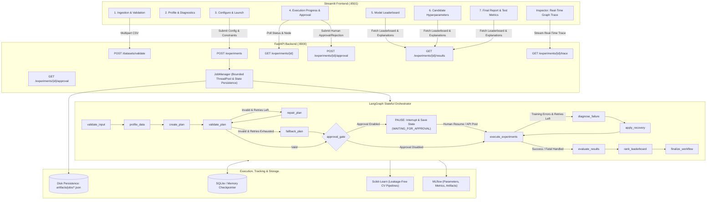

# AutoML Experiment Orchestrator

[](https://www.python.org/downloads/)
[](https://fastapi.tiangolo.com/)
[](https://streamlit.io/)
[](https://langchain-ai.github.io/langgraph/)
[](https://python.langchain.com/)
[](https://mlflow.org/)
[](https://opensource.org/licenses/MIT)

A production-grade, statefully orchestrated Automated Machine Learning (AutoML) platform designed to eliminate the most critical failure modes of conventional AutoML and naive LLM code generators — including data leakage, hallucinated hyperparameter spaces, uncontrolled loop executions, ungrounded performance reporting, and unmonitored background jobs.

Built on an explicit separation of concerns:
- **LangGraph**: Stateful workflow orchestration, cyclic plan-repair reflection loops, adaptive failure recovery, and checkpoint-backed Human-in-the-Loop (HITL) approval gates.
- **LangChain**: Schema-constrained LLM experiment planning, validation feedback reflection, and data-grounded champion explanations with deterministic zero-LLM fallbacks.
- **Scikit-Learn**: Mathematically rigorous, leakage-free cross-validation with fold-isolated preprocessing, baseline comparisons, and strictly withheld held-out test evaluation.
- **MLflow**: Parameter, metric, and champion model artifact persistence with cryptographic dataset fingerprinting.
- **FastAPI & Streamlit**: High-performance asynchronous REST backend with concurrency controls coupled to a rich multi-stage analytical dashboard and real-time Agent Workflow Inspector.

---

## Table of Contents
- [1. Architecture Principles & Solved Problems](#1-architecture-principles--solved-problems)
- [2. System Architecture](#2-system-architecture)
- [3. Separation of Concerns](#3-separation-of-concerns)
- [4. LangGraph Workflow Lifecycle & State Machine](#4-langgraph-workflow-lifecycle--state-machine)
- [5. Core Platform Capabilities](#5-core-platform-capabilities)
- [6. Verified End-to-End Scenarios (A through L)](#6-verified-end-to-end-scenarios-a-through-l)
- [7. Benchmark Experiment Report (Wisconsin Breast Cancer)](#7-benchmark-experiment-report-wisconsin-breast-cancer)
- [8. Installation & Environment Setup](#8-installation--environment-setup)
- [9. Running the System](#9-running-the-system)
- [10. REST API Specification](#10-rest-api-specification)
- [11. Interactive UI & Agent Workflow Inspector](#11-interactive-ui--agent-workflow-inspector)
- [12. Automated Verification & Testing](#12-automated-verification--testing)
- [13. Security, Guardrails & Resource Governance](#13-security-guardrails--resource-governance)
- [14. Engineering Limitations & Roadmap](#14-engineering-limitations--roadmap)

---

## 1. Architecture Principles & Solved Problems

| Traditional AutoML Failure Mode | How This Platform Solves It |
| :--- | :--- |
| **Pervasive Data Leakage**: Scalers, imputers, and encoders fitted across the full dataset prior to train/test splitting. | **Fold-Isolated Preprocessing**: Scikit-Learn `Pipeline` and `ColumnTransformer` instances are fitted exclusively inside each cross-validation fold on `X_train_fold`. |
| **Contaminated Model Selection**: Using test data to guide model selection, hyperparameter tuning, or early stopping. | **Strict Test Set Isolation**: 20% held-out test split is partitioned upfront and completely withheld from CV. Champion model ranking is based solely on validation fold metrics; the test set is evaluated exactly once after selection. |
| **Unconstrained LLM Code Generation**: Agents generating arbitrary Python code or bash scripts, risking severe security holes or hallucinated APIs. | **Schema-Constrained Planning**: LLM output is strictly bounded to structured Pydantic schemas. Model families and hyperparameters are validated against a strict deterministic catalogue. Zero arbitrary code execution. |
| **Fragile LLM Dependencies**: System crashes when the LLM service experiences network downtime, rate limits, or context errors. | **Deterministic Fallback**: Seamless zero-LLM operation via heuristic rule-based proposals and template-grounded explanations when `GROQ_API_KEY` is omitted or calls fail. |
| **Blind Retries & Infinite Loops**: Retrying failed operations blindly without diagnosing root causes or adapting configurations. | **Diagnostic Adaptive Recovery**: A dedicated diagnosis node classifies failures (convergence, timeout, invalid hyperparameters, data incompatibilities) and applies deterministic mitigations with bounded recovery attempts. |
| **Black-Box Execution**: Users unable to inspect or intervene in agent decisions before compute resources are spent. | **Human-in-the-Loop Checkpoints**: Configurable approval gate halts the state graph prior to model execution using SQLite checkpointers, exposing proposed configurations for human review, modification, or rejection. |
| **Opaque Agent Reasoning**: No visibility into agent decisions, routing transitions, or execution latency. | **Agent Workflow Inspector**: Live streaming event bus tracking node execution times, state diffs, routing decisions, repair iterations, and diagnostic traces. |

---

## 2. System Architecture



---

## 3. Separation of Concerns

```
┌────────────────────────────────────────────────────────────────────────────────────────┐
│                               SEPARATION OF RESPONSIBILITIES                           │
├───────────────────────┬────────────────────────────────────────────────────────────────┤
│ Component             │ Core Responsibilities                                          │
├───────────────────────┼────────────────────────────────────────────────────────────────┤
│ LangGraph             │ - Stateful graph orchestration and execution state management. │
│                       │ - Bounded reflection loops (plan repair & adaptive recovery).  │
│                       │ - Checkpoint-backed pauses for Human-in-the-Loop approval.     │
│                       │ - Real-time execution tracing and node transition event bus.   │
├───────────────────────┼────────────────────────────────────────────────────────────────┤
│ LangChain             │ - Schema-constrained prompt construction with system context.  │
│                       │ - Structured Pydantic output parsing (LLMExperimentProposal).   │
│                       │ - Plan repair reflection using validation error feedback.       │
│                       │ - Data-grounded executive summaries and champion explanations. │
│                       │ - Zero-LLM fallback generation when API key is unavailable.    │
├───────────────────────┼────────────────────────────────────────────────────────────────┤
│ Scikit-Learn          │ - Leakage-free preprocessing (ColumnTransformer, Imputers).     │
│                       │ - Stratified and KFold cross-validation partitioning.          │
│                       │ - Model fitting (Linear/Logistic, Tree ensembles, Boosting).   │
│                       │ - Multi-metric evaluation (Accuracy, F1, ROC-AUC, R2, RMSE).    │
│                       │ - Naive baseline comparison (DummyClassifier, DummyRegressor). │
├───────────────────────┼────────────────────────────────────────────────────────────────┤
│ MLflow                │ - Cryptographic dataset fingerprinting (SHA-256).              │
│                       │ - Hierarchical run logging (Parent workflow + child candidate).│
│                       │ - Hyperparameter, fold metric, and timing logging.             │
│                       │ - Serialization of champion model pipeline artifacts.          │
├───────────────────────┼────────────────────────────────────────────────────────────────┤
│ FastAPI & Streamlit   │ - Non-blocking RESTful background job lifecycle management.    │
│                       │ - Defensive input validation, sanitization, and rate limits.   │
│                       │ - Intuitive 7-stage interactive dashboard and Workflow Tracer. │
└───────────────────────┴────────────────────────────────────────────────────────────────┘
```

---

## 4. LangGraph Workflow Lifecycle & State Machine

### Graph Nodes

| Node Name | Functionality & State Changes |
| :--- | :--- |
| `validate_input` | Verifies dataset existence, target column, user constraints, and resource limits. |
| `profile_data` | Computes statistical metadata, infers column datatypes, detects supervised task type, and flags class imbalance. |
| `create_plan` | Constructs initial candidate model portfolio using LangChain (or deterministic fallback if LLM is absent). |
| `validate_plan` | Validates proposed candidates against catalog allowlist and user constraints. Sets `is_plan_valid` and records `validation_errors`. |
| `repair_plan` | Reflection node. Passes validation errors back to LangChain to re-prompt and repair invalid configurations. |
| `approval_gate` | HITL gate. If `requires_approval=True`, pauses execution, saves graph checkpoint, and transitions job to `WAITING_FOR_APPROVAL`. |
| `execute_experiments` | Fits baseline and candidate models across cross-validation folds using strict fold-level preprocessing. |
| `diagnose_failure` | Analyzes execution errors, classifies failure mode (convergence, timeout, resources, hyperparams), and determines recovery action. |
| `apply_recovery` | Applies grounded parameter corrections (e.g. increase `max_iter`, adjust solver, prune failing candidate) and re-executes. |
| `evaluate_results` | Evaluates the selected champion model on the strictly held-out test split (20%) and logs final MLflow runs. |
| `rank_leaderboard` | Ranks all candidate models based purely on validation fold primary metric scores. |
| `finalize_workflow` | Generates grounded natural-language explanations, packages final job payload, and completes workflow. |

### Graph Routing & Conditional Edges

```mermaid
graph TD
    V[validate_plan] -->|Valid Plan| A{Check Approval}
    V -->|Invalid & Retries < 2| R[repair_plan]
    R --> V
    V -->|Invalid & Retries >= 2| F[Fallback Plan]
    F --> A
    
    A -->|Approval Disabled| E[execute_experiments]
    A -->|Approval Enabled| P[Pause Checkpoint]
    P -->|User Approved| E
    P -->|User Rejected| FIN[finalize_workflow (Failed/Cancelled)]
    
    E -->|Success| EV[evaluate_results]
    E -->|Failure & Recoverable & Retries < 2| D[diagnose_failure]
    D --> AR[apply_recovery]
    AR --> E
    E -->|Failure & Unrecoverable| FIN
```

---

## 5. Core Platform Capabilities

### 1. Leakage-Free Data Engine
- **Upfront Train-Test Split**: A 20% test partition is segregated before any statistical preprocessing or scaling occurs.
- **Fold-Level Transformers**: Scikit-Learn `ColumnTransformer` combines `SimpleImputer` (median for numerical, most frequent for categorical), `StandardScaler`, and `OneHotEncoder(handle_unknown='ignore')`. Preprocessing parameters are estimated **only** from each training fold.
- **Champion Isolation**: Model selection and hyperparameter evaluation use validation fold mean scores exclusively. The test set is evaluated exactly once on the champion model after ranking is finalized.

### 2. Schema-Constrained LangChain Planning
- **Allowlist Model Family Catalogue**: Supports `logistic_regression`, `ridge_classifier`, `random_forest_classifier`, `gradient_boosting_classifier`, `extra_trees_classifier`, `hist_gradient_boosting_classifier`, `linear_regression`, `ridge_regression`, `lasso_regression`, `random_forest_regressor`, `gradient_boosting_regressor`, and `extra_trees_regressor`.
- **Bounded Reflection**: When invalid hyperparameters or unsupported model families are proposed, `validate_plan` captures the exact errors and passes them back to `repair_plan`. If repair retries are exhausted, the planner falls back to a deterministic candidate portfolio.

### 3. Failure Diagnosis & Adaptive Recovery
- **Deterministic Taxonomy**: Classifies exceptions into `CONVERGENCE_ERROR`, `TIMEOUT_ERROR`, `RESOURCE_ERROR`, `INVALID_HYPERPARAMETERS`, `PREPROCESSING_ERROR`, `UNSUPPORTED_MODEL`, or `UNKNOWN_ERROR`.
- **Adaptive Remediation**: Automatically increases `max_iter` for convergence failures, switches incompatible solvers (e.g., `lbfgs` to `saga`), drops degenerate candidate configurations, or scales down batch sizes, avoiding full workflow aborts.

### 4. Checkpoint-Backed Human-in-the-Loop Approval
- **Interruptible Graph State**: Uses LangGraph's checkpointer mechanism (`SqliteSaver` / `MemorySaver`) to pause execution state when `requires_approval=True`.
- **REST & UI Interactivity**: Users inspect proposed models, estimated runtime, and constraints. They can approve the plan to proceed immediately or reject it with feedback.

### 5. Real-Time Observability & Workflow Inspector
- **Streaming Event Bus**: Captures granular node lifecycles (timestamps, duration, state diffs, routing decisions, LLM proposal tokens, repair attempts, and diagnostic logs).
- **Inspection UI**: The Streamlit frontend provides a live timeline view, state transition diff viewer, routing decision log, and raw JSON trace explorer.

---

## 6. Verified End-to-End Scenarios (A through L)

The platform is verified across 12 end-to-end integration scenarios implemented in `tests/integration/test_scenarios_e2e.py`:

| Scenario | Objective | Validation Verification |
| :--- | :--- | :--- |
| **Scenario A** | Normal Classification Workflow | Stratified split, baseline comparison, 3 candidate models, champion selected strictly on CV F1-macro, held-out test evaluation completed. |
| **Scenario B** | Normal Regression Workflow | Continuous target, R2/RMSE metrics, DummyRegressor baseline, regression model leaderboard. |
| **Scenario C** | LLM Unavailable / Deterministic Fallback | `GROQ_API_KEY` unset; system seamlessly falls back to rule-based proposal and template-grounded explanation. |
| **Scenario D** | Invalid LLM Plan & Successful Repair | LLM proposes invalid model; `validate_plan` detects error; `repair_plan` provides feedback; corrected plan passes validation and completes. |
| **Scenario E** | Invalid LLM Plan & Retry Exhaustion | LLM repeatedly outputs invalid configurations; retry limit reached; system safely falls back to deterministic proposal and completes. |
| **Scenario F** | Candidate Failure & Adaptive Recovery | Candidate triggers a convergence error; `diagnose_failure` identifies failure mode; `apply_recovery` increases `max_iter`; re-execution succeeds. |
| **Scenario G** | Unrecoverable Candidate Failure | Fatal data incompatibility encountered; diagnosis marks failure unrecoverable; workflow terminates cleanly with status `FAILED` and sanitized error message. |
| **Scenario H** | Human Approval & Successful Resume | Workflow pauses at `approval_gate` (`WAITING_FOR_APPROVAL`); state persisted to SQLite checkpointer; approved via API; workflow resumes and completes. |
| **Scenario I** | Human Rejection | Workflow pauses at `approval_gate`; rejected via API; workflow terminates gracefully with status `REJECTED` and zero candidate training compute wasted. |
| **Scenario J** | Non-Default User Constraints | Custom constraints (`primary_metric="roc_auc"`, `cv_folds=4`, `test_size=0.25`, `random_seed=99`) propagate from API/UI to workflow and trainer. |
| **Scenario K** | MLflow Experiment & Artifact Tracking | Parent run and child candidate runs logged with parameters, metrics, dataset SHA-256 fingerprint, and serialized champion model. |
| **Scenario L** | Real-Time Observability & Polling | `WorkflowObserver` streams node durations, state diffs, and routing decisions to `/experiments/{id}/trace` during live execution. |

---

## 7. Benchmark Experiment Report (Wisconsin Breast Cancer)

Real execution benchmark on the Wisconsin Breast Cancer diagnostic dataset (569 samples, 30 numeric features, binary classification):

```
Dataset Profile:
  • Samples: 569 rows | 31 columns
  • Partition: 455 training rows (80%) | 114 held-out test rows (20%)
  • Supervised Task: binary_classification
  • Primary Optimization Metric: f1_macro (3-Fold Stratified CV)
```

### Official Model Leaderboard
| Rank | Model Candidate | Family | Mean CV F1-Macro | CV Std Dev | Training Time | Status |
| :---: | :--- | :--- | :---: | :---: | :---: | :---: |
| 🏆 **1** | **Logistic Regression** | `logistic_regression` | **0.9764** | **±0.0106** | **0.33s** | **SUCCESS (Champion)** |
| 2 | Random Forest Classifier | `random_forest_classifier` | 0.9532 | ±0.0195 | 2.03s | SUCCESS |
| 3 | Gradient Boosting | `gradient_boosting_classifier`| 0.9484 | ±0.0204 | 1.59s | SUCCESS |
| 4 | Dummy Majority Baseline | `dummy_classifier` | 0.3851 | ±0.0000 | 0.28s | SUCCESS (Baseline) |

### Held-Out Generalization Verification
- **Selected Champion**: Logistic Regression (`C=1.0`, `max_iter=1000`, `StandardScaler`, `SimpleImputer(median)`)
- **Validation CV F1-Macro**: `0.9764` (evaluated on training folds only)
- **Held-Out Test F1-Macro**: `0.9825` (evaluated on strictly withheld 114 test rows)
- **Held-Out Test Accuracy**: `0.9825`
- **Held-Out Test ROC-AUC**: `0.9954`
- **Generalization Gap**: `+0.0061` (Test score matches validation estimate, proving zero data leakage or selection bias)
- **MLflow Tracking Run**: Parent Run ID `d52a66aecd5c40db9c345599e2bd8d04`

---

## 8. Installation & Environment Setup

### Prerequisites
- Python 3.10, 3.11, or 3.12
- Git

### 1. Clone & Set Up Virtual Environment
```bash
# Clone the repository
git clone https://github.com/HimanshuMali701/automl-experiment-orchestrator.git
cd automl-experiment-orchestrator

# Create virtual environment
python -m venv venv

# Activate virtual environment
# Windows PowerShell:
.\venv\Scripts\activate
# Linux / macOS:
source venv/bin/activate
```

### 2. Install Dependencies
```bash
pip install -r requirements.txt
```

### 3. Environment Configuration
Create a `.env` file in the project root:
```ini
# Networking
API_HOST=127.0.0.1
API_PORT=8000
AUTOML_API_BASE_URL=http://127.0.0.1:8000

# Concurrency & Resource Limits
MAX_CONCURRENT_JOBS=2
MAX_UPLOAD_SIZE_MB=50
MAX_DATASET_ROWS=100000
MAX_DATASET_COLS=200
MAX_TRAINING_TIME_SECONDS=600

# Checkpointing Store
CHECKPOINT_DB_PATH=./artifacts/checkpoints.db

# MLflow Tracking Store
MLFLOW_TRACKING_URI=file:./mlruns
MLFLOW_DEFAULT_EXPERIMENT_NAME=automl-experiments

# Optional Groq LLM (Leave blank for deterministic fallback)
GROQ_API_KEY=
GROQ_MODEL=openai/gpt-oss-20b
```

---

## 9. Running the System

For local interactive development, run the backend and dashboard in **two separate terminal windows**:

### Terminal 1: Launch FastAPI Backend
```bash
# Activate virtual environment
.\venv\Scripts\activate

# Launch Uvicorn server
uvicorn automl.api.app:app --host 127.0.0.1 --port 8000 --reload
```
Interactive OpenAPI documentation will be accessible at: `http://127.0.0.1:8000/docs`

### Terminal 2: Launch Streamlit Dashboard
```bash
# Activate virtual environment
.\venv\Scripts\activate

# Launch Streamlit dashboard
streamlit run src/automl/ui/app.py --server.port 8501
```
Open your browser at: `http://localhost:8501`

### Programmatic Headless Journey
To simulate the complete end-to-end user journey programmatically from raw CSV ingestion to final test set evaluation:
```bash
python examples/run_ui_journey_demo.py
```

---

## 10. REST API Specification

| Method | Endpoint | Description |
| :--- | :--- | :--- |
| `GET` | `/health` | Service health status, active job count, and system configuration. |
| `POST` | `/datasets/validate` | Validates uploaded CSV, infers schema, checks health warnings, and returns dataset ID. |
| `POST` | `/experiments` | Submits experiment with target column, constraints, and optional approval flag. |
| `GET` | `/experiments/{id}` | Returns current job lifecycle status (`QUEUED`, `RUNNING`, `WAITING_FOR_APPROVAL`, `COMPLETED`, `FAILED`). |
| `GET` | `/experiments/{id}/results` | Returns ranked model leaderboard, baseline comparisons, test metrics, and explanations. |
| `GET` | `/experiments/{id}/approval` | Retrieves pending experiment plan and validation summary when waiting for approval. |
| `POST` | `/experiments/{id}/approval` | Submits human decision (`approved=True/False`) with optional feedback to resume/abort execution. |
| `GET` | `/experiments/{id}/trace` | Returns real-time streaming observability trace, node durations, state diffs, and routing logs. |

---

## 11. Interactive UI & Agent Workflow Inspector

The Streamlit dashboard (`src/automl/ui/app.py`) provides an end-to-end interface structured across 7 workflow stages plus an observability tab:

1. **Dataset Ingestion & Validation**: Drag-and-drop CSV upload, row/column size checks, and instant health diagnostics.
2. **Dataset Profile & Diagnostics**: Interactive statistical profile showing datatype distributions, missing value counts, and class balance ratios.
3. **Configure & Launch Experiment**: Select target column, override primary optimization metric, configure CV folds, set test split size, and enable Human-in-the-Loop approval.
4. **Execution Progress & Human Approval**: Real-time stage polling with dynamic stage indicators and an interactive Plan Approval Panel (Review Proposed Candidates, Approve, or Reject).
5. **Model Benchmark Leaderboard**: Interactive leaderboard comparing candidate models against majority/mean baselines with validation CV mean and variance.
6. **Candidate Detail & Hyperparameters**: Deep-dive inspector displaying exact hyperparameters, fold-level score distributions, and training durations.
7. **Final Report & Champion Insights**: Generalization verification displaying held-out test set performance, generalization gap, grounded LLM executive summaries, and MLflow run links.
8. **Agent Workflow Inspector**: Live telemetry visualizing node execution durations, state transition summaries, routing decisions, LLM proposal/repair attempts, and raw JSON traces.

---

## 12. Automated Verification & Testing

The repository contains an exhaustive automated test suite covering unit tests, integration tests, data leakage guards, schema validation, and complete end-to-end scenarios.

### Run All Automated Tests
```bash
pytest -v
```

### Test Suite Structure
| Test File | Focus & Scope |
| :--- | :--- |
| `tests/unit/test_env_sanity.py` | Virtual environment, Python version, dependencies, and path sanity. |
| `tests/unit/test_profiler.py` | Statistical profiling, datatype inference, target task detection, and quality warnings. |
| `tests/unit/test_trainer.py` | Leakage-free fold pipelines, stratified splitting, metric calculation, and baseline comparison. |
| `tests/unit/test_planner.py` | Schema parsing, catalog allowlists, prompt templates, and deterministic fallback. |
| `tests/unit/test_tracking.py` | MLflow run creation, metric logging, dataset fingerprinting, and artifact saving. |
| `tests/unit/test_workflow.py` | LangGraph state transitions, retry limits, and error handling. |
| `tests/unit/test_user_constraints.py` | User constraint propagation from API/UI to workflow and trainer. |
| `tests/unit/test_planner_reflection.py` | Bounded plan repair loop, validation feedback reflection, and retry exhaustion. |
| `tests/unit/test_adaptive_recovery.py` | Failure diagnosis taxonomy, parameter adaptations, and recovery routing. |
| `tests/unit/test_approval.py` | Human-in-the-loop checkpoint pauses, state resumption, and rejection handling. |
| `tests/unit/test_observability.py` | Streaming event bus, node timing measurements, and trace retrieval endpoints. |
| `tests/unit/test_qa_portfolio_readiness.py` | Zero-leakage verification, regression/classification suites, zero-LLM resilience. |
| `tests/unit/test_ui.py` | Streamlit AppTest component rendering and API client resilience. |
| `tests/integration/test_api.py` | FastAPI REST endpoints, job lifecycle transitions, and RFC-7807 error responses. |
| `tests/integration/test_scenarios_e2e.py` | Comprehensive verification of End-to-End Scenarios A through L. |

---

## 13. Security, Guardrails & Resource Governance

### Security Guardrails
- **Zero Arbitrary Execution**: Users cannot provide arbitrary Python code, shell commands, or unvetted model imports.
- **Strict Model Allowlisting**: Only verified Scikit-Learn estimators from `src/automl/planner/catalogue.py` are instantiated.
- **Privacy Masking**: Raw dataset rows are never persisted in MLflow tags or server logs; only statistical summaries and SHA-256 hashes are stored.
- **Defensive Error Handling**: Internal exceptions are caught and sanitized to prevent exposing system paths, database credentials, or API keys.

### Resource Limits
- `MAX_UPLOAD_SIZE_MB`: 50 MB
- `MAX_DATASET_ROWS`: 100,000 rows
- `MAX_DATASET_COLS`: 200 columns
- `MAX_CONCURRENT_JOBS`: 2 active training jobs (returns HTTP 429 when saturated)
- `MAX_TRAINING_TIME_SECONDS`: 600 seconds per-experiment ceiling

---

## 14. Engineering Limitations & Roadmap

### Honest Engineering Appraisal
1. **Tabular Focus**: Specializes in structured tabular datasets; does not ingest computer vision, raw text corpora, or sequential time-series data.
2. **Local Background Queue**: Uses an in-memory `ThreadPoolExecutor` and local disk persistence. Multi-node cloud deployments require replacing `JobManager` with a distributed queue (e.g. Celery + Redis).
3. **Model Selection**: Currently benchmarks standard Scikit-Learn estimators. Deep learning architectures (PyTorch/TensorFlow) and multi-GPU distributed training are excluded.

### Future Roadmap
- [ ] Add LightGBM, XGBoost, and CatBoost to the verified candidate catalogue.
- [ ] Add Celery + Redis distributed background task backend.
- [ ] Add automated probability calibration (Isotonic/Platt) and custom cost-matrix threshold tuning.
- [ ] Add TreeSHAP and permutation feature importance visualizations to the Streamlit report view.
- [ ] Add one-click Dockerfile and ONNX runtime export for the champion model.

---

## License
MIT License. Created for production-grade AutoML experimentation and portfolio demonstration.
